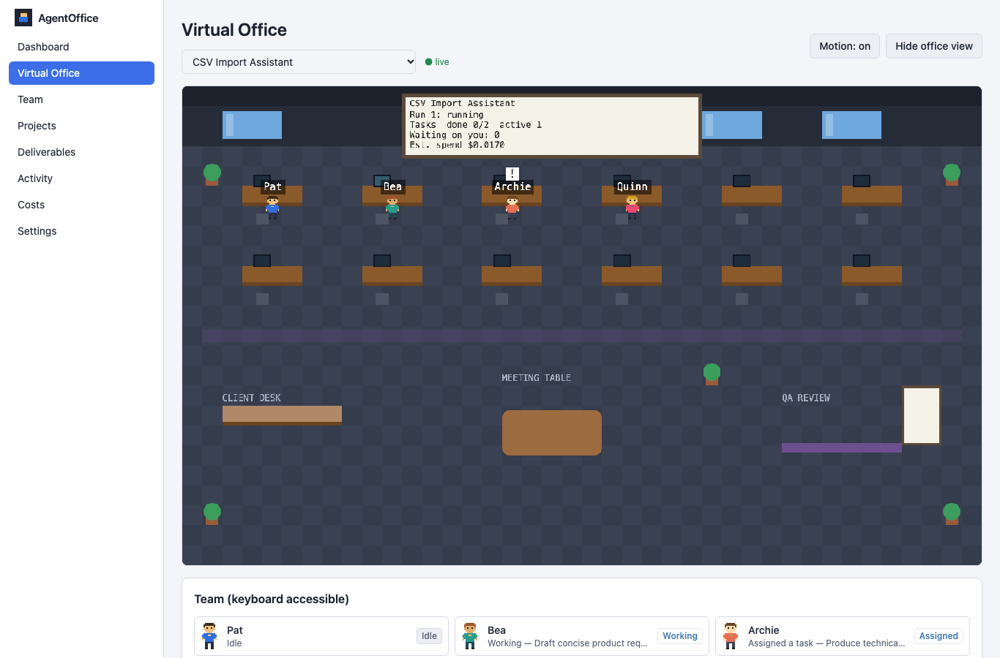
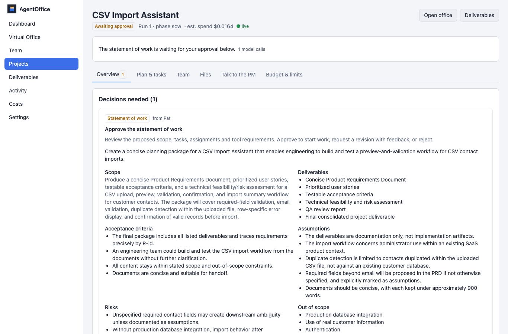
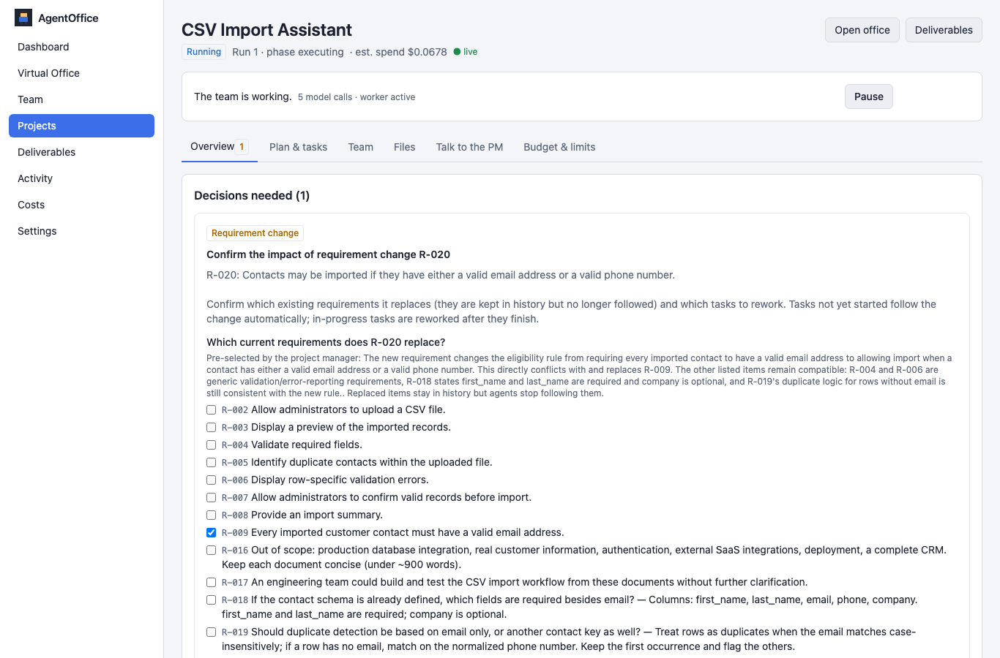
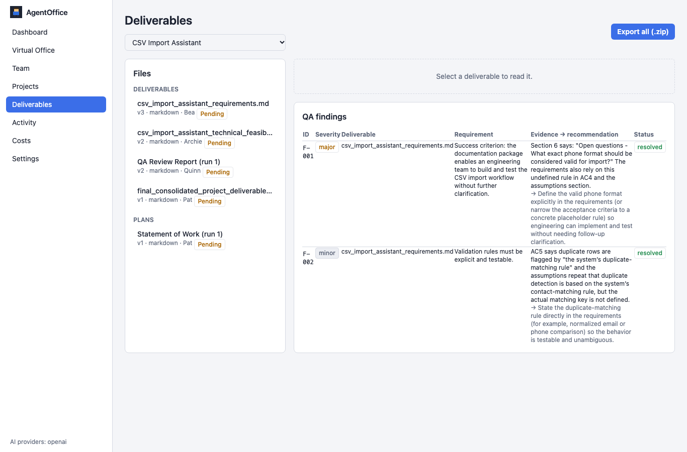
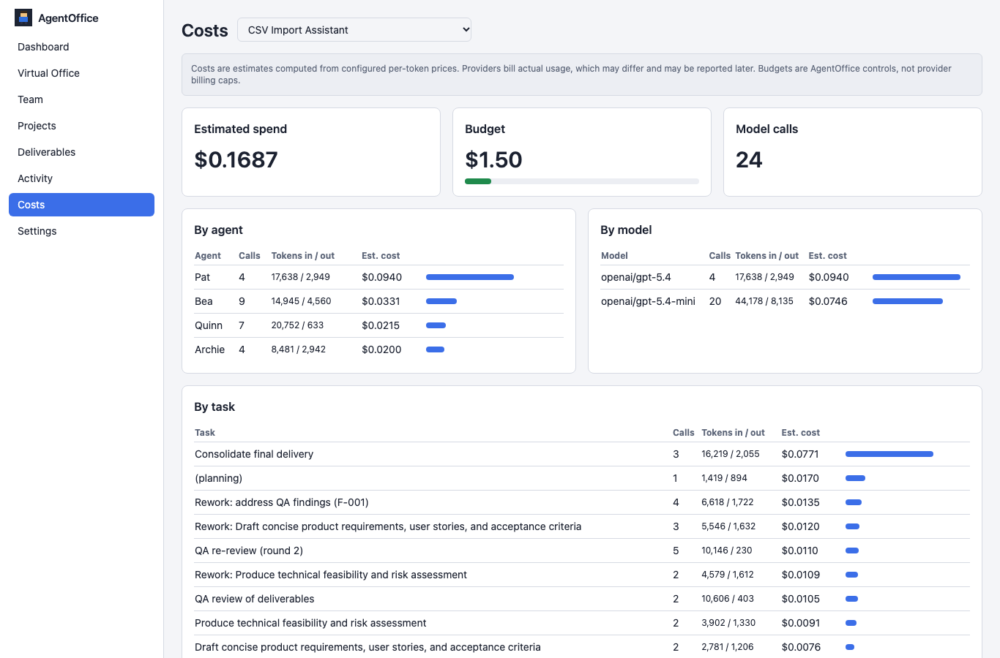
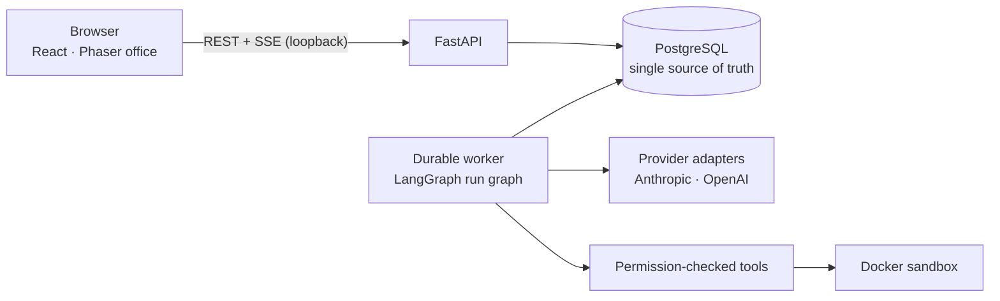
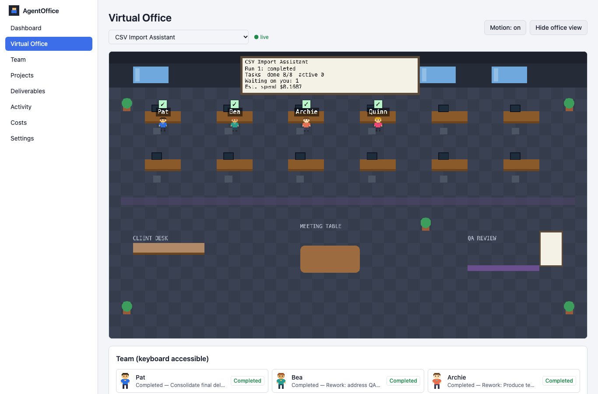

<div align="center">


# AgentOffice

**Your own AI project team, without the overhead of managing one.**

Build your AI team, delegate complex work, manage changing requirements, and turn ideas into
deliverables through an intuitive visual workspace. A Project Manager agent plans, specialist agents
do the work, a QA agent reviews it, and *you* stay the client: approving scope, answering questions,
changing requirements mid-project, and controlling spend. It's local-first and no-code, and it all
plays out live in a pixel-art office.


[](LICENSE)



</div>

---

## Who it's for

AgentOffice is for people with ambitious projects who need a team, not necessarily people whose job
title involves managing one:

- **Solo founders and entrepreneurs:** validating ideas, researching competitors, writing MVP specs,
  building prototypes.
- **University students:** capstones, product-management assignments, research and software projects.
- **Product managers and business analysts:** requirements, user stories, process analysis,
  stakeholder changes and deliverable review.

They all already use AI. The hard part is coordination:
- context is spread across separate chats;
- nobody clearly owns each piece;
- outputs go unreviewed;
- every requirement change means working out by hand what is now wrong.

AgentOffice gives that work one plan, named owners, reviewed and versioned deliverables, and change
handling that knows what depends on what.

## Why AgentOffice?

Visual agents and multi-model teams aren't unique on their own. What AgentOffice focuses on is
**managing complex, evolving projects** with clear responsibility, costs, deliverables and changes.
It translates agent engineering into project language, and the office is the window onto that work,
not the point of it:

| Engineering concept | In AgentOffice |
|---|---|
| Orchestrator | Your **Project Manager**, who plans and delegates |
| Agent config / system prompt | An **employee profile** and job description |
| Model selection | Each consultant's **model and cost tier** |
| Task graph | A **statement of work** you approve or edit |
| Human-in-the-loop | **Client decisions**: questions, approvals, budget calls |
| Token usage | **Billable usage**, per agent, task and model |
| Artifacts | **Versioned deliverables** with QA findings |

And it's honest by design. Nothing in the office animates unless a real backend event happened, costs
are labelled as estimates, and a QA "pass" is described as an opinion rather than proof.

## What it does

**🧑‍💼 Build a team.** Hire from 8 built-in roles (PM, Business Analyst, Research Analyst, Architect,
Developer, QA, Technical Writer, Data Analyst) or create your own. Give **each agent its own model**:
Claude for planning, a cheaper model for drafting, whatever fits the budget. Start from templates for
product requirements, competitive analysis, software prototypes or business process analysis, or
describe any goal. A template only presets the team and deliverables; every project runs on the same engine.

**📋 Approve the plan.** The PM turns your brief into a statement of work: tasks, dependencies,
assignees, acceptance criteria, risks and tool needs. Every task cites the requirement IDs (R-001…) it
implements. Edit assignments, drop tasks or answer the PM's questions, then approve. Nothing runs before you do.



**🏢 Watch real work.** Tasks run in parallel where dependencies allow. Agents delegate, hand off, ask
you questions (you'll see them waiting at the client desk ✋) and review each other's output. Click any
agent to see its current task, tokens, spend, hand-offs, and the raw conversation in an advanced view.

**🔁 Change your mind mid-project.** This is the part most systems get wrong.
1. Submit a change.
2. The PM proposes which requirements it **replaces**.
3. AgentOffice computes, from task-to-requirement links and artifact lineage, **exactly which work is
   affected**: completed work, work in progress (reworked after it finishes) and downstream tasks.
   Everything else is kept. Each affected task shows an **estimated rework cost** (from what it used
   the first time, at its agent's current model price), totalled against your remaining budget.
4. You confirm.
5. A deterministic gate then **blocks delivery of any document still based on a retired requirement**.



**✅ Get reviewed deliverables.** QA checks every deliverable against the acceptance criteria and sends
targeted rework, in bounded cycles. Deliverables are versioned, with lineage showing which requirements
each version implements and which inputs it came from. Export Markdown, DOCX, JSON, CSV or a ZIP with
a manifest.

**💸 Stay in control of spend.**
- **Budgets per project, agent and task**, checked *before* every call.
- **No early stops:** when the budget is tight, a call's output allowance is reduced to what you can
  afford instead of stopping the run.
- **Full breakdowns** of tokens and estimated cost per agent, task and model.

<p>


</p>

## Does it actually work?

AgentOffice was tested end-to-end by an autonomous QA run that drove the real UI with Playwright and
**real OpenAI models**, including a requirement change mid-project. All evidence (every artifact
version, event log, usage record and screenshot) is committed in [`docs/`](docs):

- **[Acceptance report](docs/AGENTOFFICE_E2E_ACCEPTANCE_REPORT.md):** a full client journey, five defects
  found and fixed, re-verified live.
- **[Change management and multi-agent vs single-agent study](docs/CHANGE_MANAGEMENT_VALIDATION.md):**
  identical brief, identical change, same model, blind AI-evaluated.

| Same brief + mid-project change, gpt-5.4 | Single agent | Multi-agent team |
|---|---|---|
| Blind rubric score (AI evaluator, blinded) | 19 / 35 | **29 / 35** |
| Deterministic deliverable checks | 14 / 16 | **16 / 16** |
| Real defects found and fixed by its own QA | 0 (no QA) | **3** |
| Estimated cost | **$0.14** | $0.51 |
| Execution time | **69 s** | 187 s |

These are honest numbers: on this task, the team produced clearly better, more testable documents,
for about 3.6× the cost. AgentOffice lets you pick that trade-off per project.

## Quick start

**You need:** macOS or Linux, [Docker Desktop](https://www.docker.com/products/docker-desktop/),
Python 3.11+, Node 18+, and an **API key** from the
[Anthropic Console](https://console.anthropic.com/) and/or the [OpenAI platform](https://platform.openai.com/).
A Claude Pro or ChatGPT Plus subscription does not include API credits.

```bash
git clone https://github.com/niloyfaiyaz/AgentOffice.git
cd AgentOffice
./agentoffice start
```

The first start installs everything, starts PostgreSQL in Docker, builds the code sandbox and the UI,
then opens **http://127.0.0.1:8765** with a one-time sign-in link. Then:

1. **Settings:** paste your API key. It's stored in your OS keychain, never in the database or the browser.
2. **New project:** describe what you want in your own words, optionally with files or a template.
3. **Clarify:** your Project Manager asks only the questions that matter and drafts an editable brief.
   Every item is labelled *from you* or *AI proposal*.
4. **Team:** accept the recommended team, which is the smallest that covers the brief, or customize
   models, instructions, tools and limits.
5. **Review & approve:** requirements, team, plan, permissions and budget on one screen, then
   **Approve & Start Project**.
6. **Work in the project's office:** see what each agent is doing and who is waiting on whom,
   message the team or one agent, and answer questions. Your Inbox collects every decision across
   projects.

```bash
./agentoffice open        # sign this browser in again (e.g. after clearing cookies)
./agentoffice stop --all   # stop everything
./agentoffice logs         # server and worker logs
./agentoffice test         # backend and UI test suites
./agentoffice cleanup-test-data   # dry run: find synthetic test projects (--mark hides, --delete --yes removes)
```

## Privacy and security

- **Local-first.** Projects, files and history live on your machine (PostgreSQL in Docker, files under `data/`).
- **BYOK.** Your keys go to your OS keychain (encrypted-file fallback). Prompts go only to the providers
  *you* configure. No telemetry.
- **Locked local API.** The app binds to `127.0.0.1` and every API request needs a random
  per-install token, so other programs and users on your computer can't spend your API credits.
  The launcher signs your browser in with an HttpOnly, same-site-only cookie. Host-header checks
  block DNS rebinding, and a required header on writes blocks cross-site requests.
- **Private database.** PostgreSQL listens on `127.0.0.1` only, with a random per-install password
  kept in the git-ignored `.env`.
- **Sandboxed code.** Agent-written code runs in throwaway Docker containers: no network, read-only
  root, non-root user, CPU, memory and time limits. Each run needs your authorization.
- **Untrusted inputs.** Uploaded documents are treated as data, wrapped so agents can't be steered by
  instructions inside them.
- **Server-side permissions.** Tool permissions are enforced on the server, so an agent can't grant
  itself new powers.
- **Supply chain.** Docker images are pinned by digest, dependencies are audited, and Dependabot
  proposes updates. See [SECURITY.md](SECURITY.md) to report a vulnerability.

## How it works



- **One state, one engine, one event stream.** The LangGraph run graph and the task table in Postgres
  drive execution. Every state change is an event; the office and the timeline render those events.
- **Durable.** A leased worker survives restarts. Every agent conversation is checkpointed, so tasks
  pause, wait for you and resume without losing tool calls.
- **Traceable.** Requirements are versioned items. Tasks link to the requirements they implement,
  and each artifact version records its requirements and exact inputs, which powers change impact
  and the stale-delivery gate.

More detail: [Product strategy](docs/PRODUCT_STRATEGY.md) · [UX journey](docs/UX_JOURNEY_REDESIGN.md) · [Architecture](docs/ARCHITECTURE.md) ·
[Engineering report](docs/ENGINEERING_REPORT.md) ·
[Open-source assessment](docs/OPEN_SOURCE_FOUNDATION_ASSESSMENT.md).

## Tech stack

**Backend:** Python, FastAPI, Pydantic, LangGraph (+ Postgres checkpointer), SQLAlchemy and Alembic,
the official `anthropic` and `openai` SDKs, keyring and cryptography.
**Frontend:** React, TypeScript, Vite, Tailwind, Phaser 3 (original procedural pixel art), TanStack Query.
**Testing:** pytest (against real Postgres and Docker), Vitest with React Testing Library, Playwright.

## Status and roadmap

AgentOffice is a working v1, verified end-to-end with OpenAI. The full picture, including what is
implemented, partial and planned for each audience, is in the
**[product strategy](docs/PRODUCT_STRATEGY.md)**.

**Implemented:**
- a conversational project start: clarify, prefilled editable brief, recommended team, one
  integrated approval ([UX redesign](docs/UX_JOURNEY_REDESIGN.md));
- a project-centred workspace with a project switcher, team and agent messaging, and a global inbox;
- the visual office and task board;
- configurable teams with per-agent models and permissions;
- change-aware rework with a stale-delivery gate;
- versioned, traceable, QA-reviewed deliverables;
- an estimated rework cost on every requirement change;
- enforced budgets and cost breakdowns.

**Planned:**
- [ ] An estimated plan cost before approval
- [ ] Academic assistance levels (brainstorm, critique, guided learning, permitted implementation)
      with an exportable AI-use record
- [ ] More starting points: validate a startup idea, MVP specification, capstone plan, rubric review
- [ ] Live verification with Anthropic models (the adapter is contract-tested only)
- [ ] Tighter requirement linking by the PM (broad links limit how much work a change can preserve)
- [ ] Section-level lineage (today a change reworks a whole document)
- [ ] A built-in self-review step for single-agent teams
- [ ] Web research beyond Anthropic's built-in search (under evaluation)

Issues and pull requests are welcome. Please run `./agentoffice test` before submitting.

## License

[MIT](LICENSE). You're free to use, modify and distribute it, including commercially.

## Configuration

| Variable | Default | Purpose |
|---|---|---|
| `AGENTOFFICE_PORT` | `8765` | UI and API port (always bound to 127.0.0.1) |
| `AGENTOFFICE_DATABASE_URL` | local Docker Postgres | Database connection |
| `AGENTOFFICE_DB_PASSWORD` | random, in `.env` | Password for the local Docker Postgres |
| `AGENTOFFICE_API_TOKEN` | random, in `data/api-token` | Local API token (send as `Authorization: Bearer …`) |
| `AGENTOFFICE_DATA_DIR` | `./data` | Uploads, exports, sandbox scratch |
| `AGENTOFFICE_CREDENTIAL_BACKEND` | `auto` | `keyring` or `encrypted_file` |
| `AGENTOFFICE_CREDENTIAL_PASSPHRASE` | — | Unlock secret for the encrypted-file fallback |
| `AGENTOFFICE_ENABLE_TEST_PROVIDER` | off | Scripted, **non-AI** provider used by automated tests |

---

<div align="center">

<br/>
<sub>Built with Claude Code. Every pixel is original procedural art, with no third-party sprites.</sub>
</div>
